<div align="center">

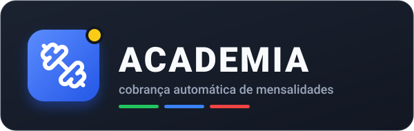

<p><strong>Sistema de cobrança automática da Corpu's Academia: mensalistas, validade dos planos, inadimplentes e avisos de vencimento por e-mail e WhatsApp.</strong></p>

<p><a href="https://academia-systemfinance.vercel.app"><b>academia-systemfinance.vercel.app</b></a></p>

<a href="#pré-visualização"></a>


<a href="https://academia-systemfinance.vercel.app"></a>

<a href="docs/CONFORMIDADE.md"></a>
<a href="docs/CONFORMIDADE.md#4-acessibilidade-wcag-21-aa"></a>
<a href="#design"></a>

</div>

---

## Pré-visualização

<p align="center">
  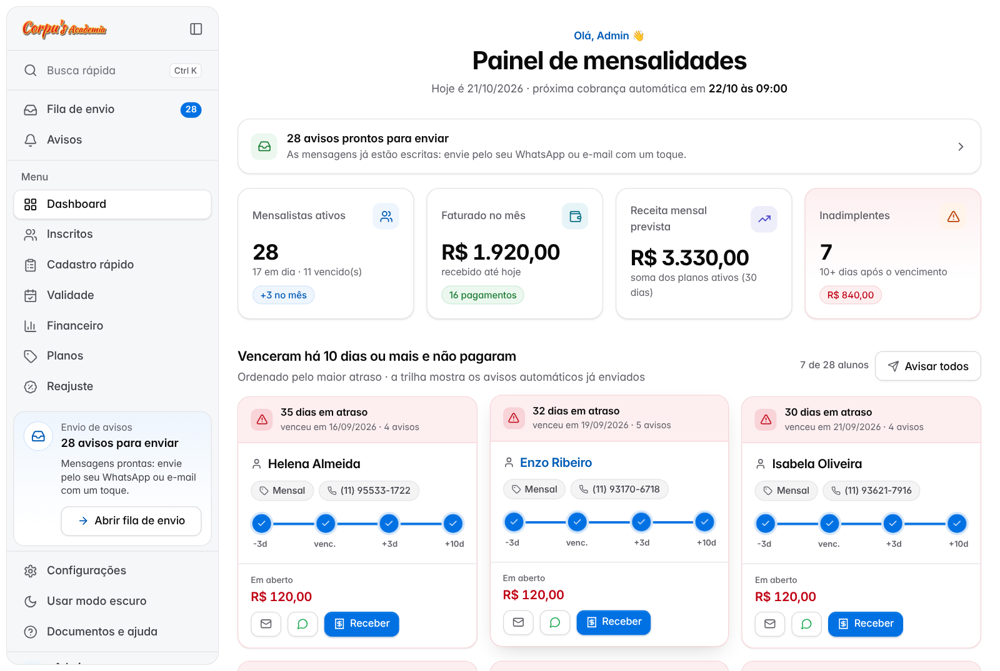
</p>
<p align="center"><sub>Captura real do painel (modo claro, sidebar aberta), com alunos fictícios de demonstração.</sub></p>

<p align="center">
  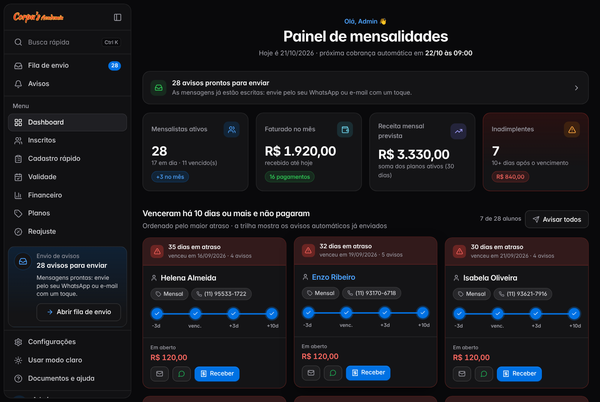
</p>
<p align="center"><sub>Modo escuro (tokens escuros do shadcn/ui).</sub></p>

<p align="center">
  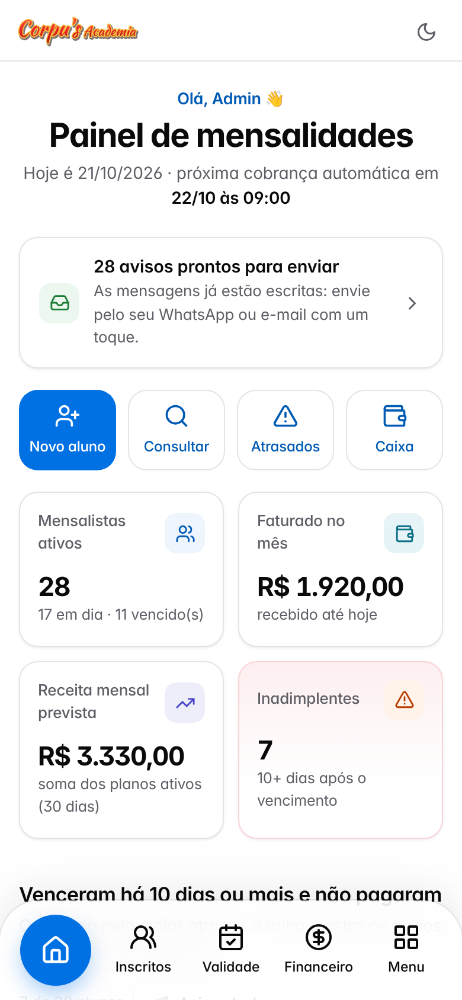
  &nbsp;
  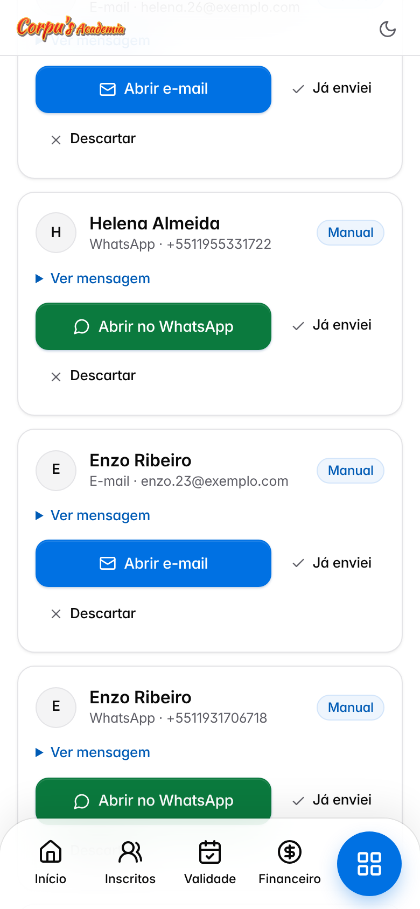
  &nbsp;
  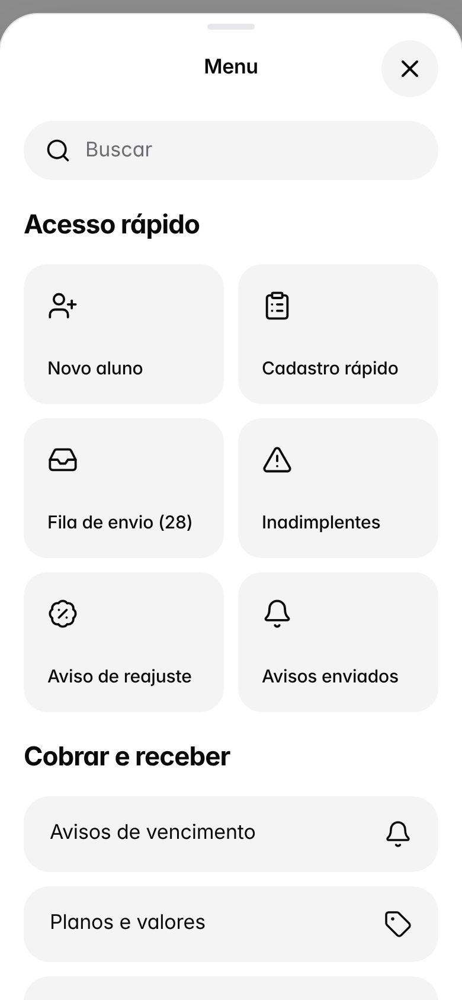
</p>
<p align="center"><sub>Celular: ações rápidas em cartões, fila de envio com um toque para o WhatsApp e menu em tela cheia.</sub></p>

<table>
  <tr>
    <td width="33%" align="center">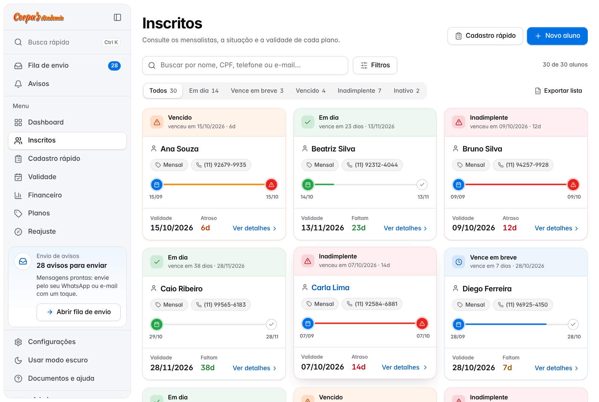<br><sub><b>Inscritos</b>: situação e validade de cada aluno</sub></td>
    <td width="33%" align="center">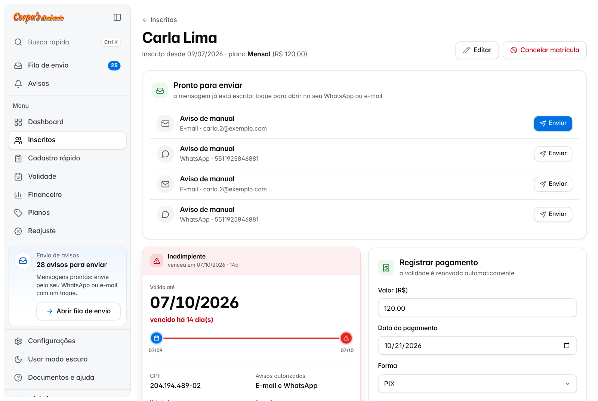<br><sub><b>Ficha do aluno</b>: pagamento e avisos</sub></td>
    <td width="33%" align="center">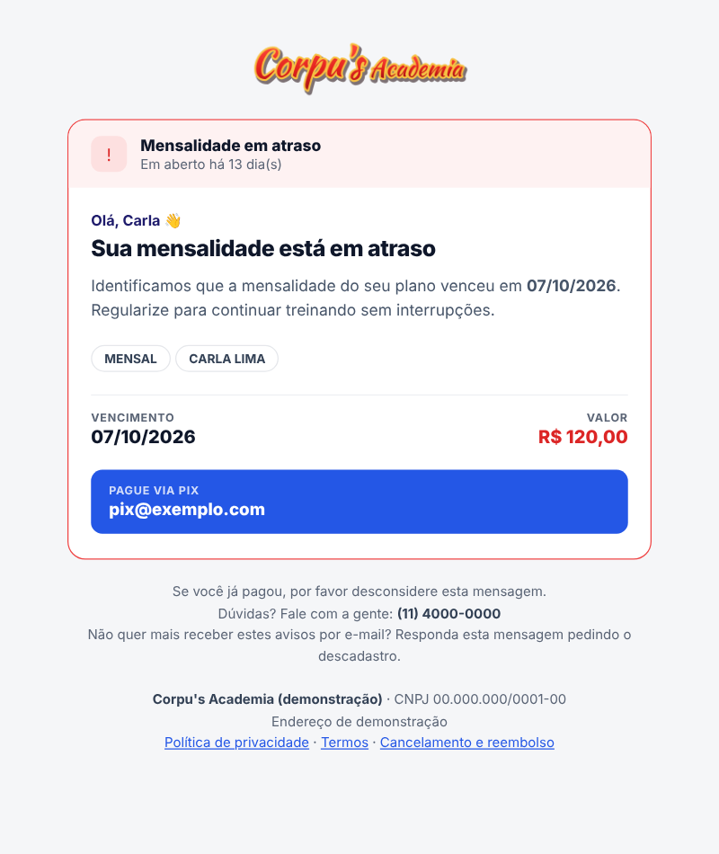<br><sub><b>E-mail</b> que o aluno recebe</sub></td>
  </tr>
  <tr>
    <td width="33%" align="center">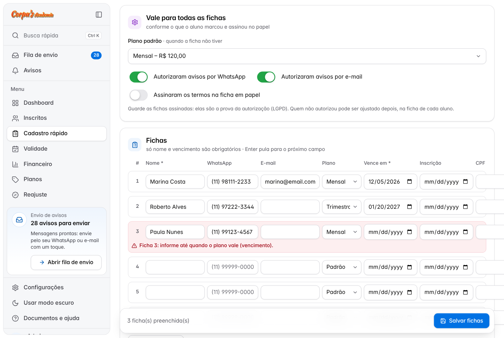<br><sub><b>Cadastro rápido</b>: fichas em papel coladas do Excel, em revisão</sub></td>
    <td width="33%" align="center">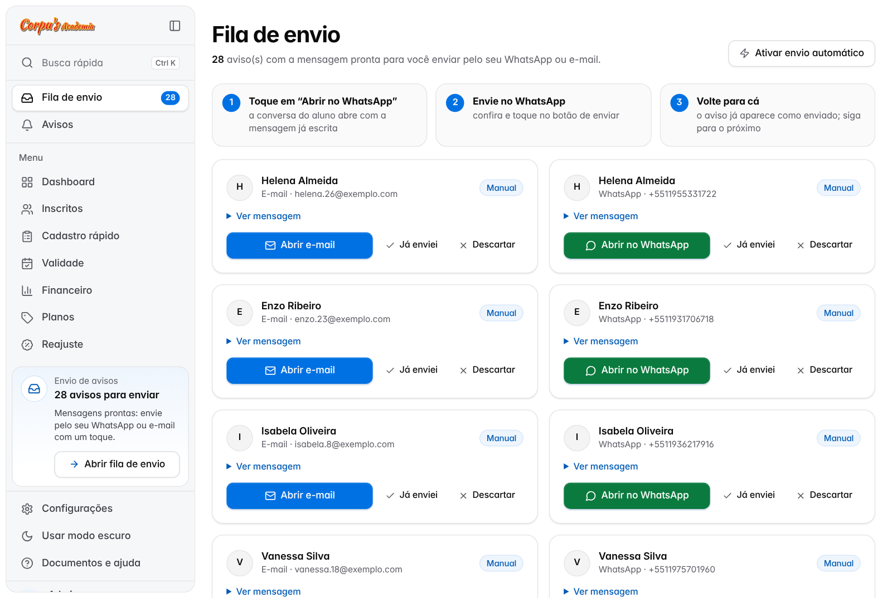<br><sub><b>Fila de envio</b>: um toque para enviar pelo seu WhatsApp</sub></td>
    <td width="33%" align="center">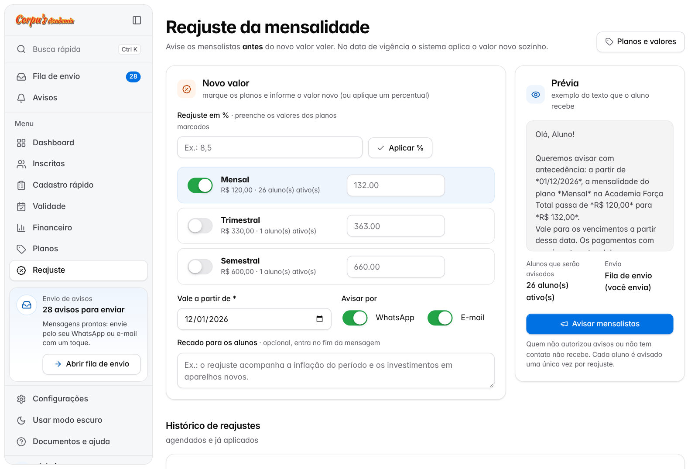<br><sub><b>Reajuste</b>: aviso antecipado aos mensalistas</sub></td>
  </tr>
</table>

### Design

- **shadcn/ui** como sistema de design: os mesmos tokens (`--background`, `--card`, `--primary`, `--muted`, `--border`, `--ring`,
  `--radius`) e as receitas de *Sidebar*, *Button*, *Card*, *Badge*, *Input*, *Tabs*, *Popover*, *Drawer*, *AlertDialog* e *Sonner*,
  escritas em CSS puro. Os ícones são do **Lucide**, a biblioteca de ícones do shadcn/ui (gerados do pacote oficial).
  Assim o sistema continua leve (Flask + Jinja, sem React e sem etapa de build) e a política de segurança segue `default-src 'self'`.
- **Movimento no estilo Apple**: transição suave entre páginas (View Transitions), com o círculo da aba ativa deslizando até a nova aba;
  entrada em cascata; molas ao tocar em botões e cartões; números dos indicadores contando até o valor; barras e trilhas que crescem;
  troca de tema em círculo a partir do botão; menu que sobe com a curva das folhas do iOS e fecha arrastando a alça.
  Tudo é desligado quando o aparelho pede **menos movimento**.
- **Computador**: sidebar lateral (variante *floating* do shadcn/ui) com busca rápida (**Ctrl+K**), contador da fila de envio,
  seções do menu, cartão com a situação do envio, modo escuro e usuário no rodapé. Recolhe para só ícones (**Ctrl+B**) e
  lembra a escolha; em telas médias já começa recolhida.
- **Celular**: barra de abas flutuante com ícones Lucide, cartões tocáveis por inteiro, ações rápidas no painel e na ficha do aluno, tabelas viram listas em cartão,
  confirmações em folha na parte de baixo da tela e mensagens que aparecem no topo e somem sozinhas.

Feito em **Python + Flask**. No computador usa **SQLite** (não precisa instalar banco de dados); na nuvem
(Vercel) usa **Postgres**. Roda em Windows, Mac ou Linux com Python 3.10 ou mais novo.

## Funcionalidades

| Tela | O que faz |
|---|---|
| **Dashboard** | Nº de mensalistas ativos, faturado no mês, receita mensal prevista, gráfico dos últimos 6 meses e a lista de quem **venceu há 10 dias ou mais e não pagou**, com botões de e-mail, WhatsApp e "Receber" |
| **Inscritos** | Busca por nome, CPF, telefone ou e-mail, situação (em dia, vence em breve, vencido, inadimplente, inativo) e **filtros** por plano, contato/autorização, faixa de vencimento e ordenação. Os filtros aparecem como etiquetas removíveis e a lista filtrada pode ser **exportada** para o Excel |
| **Cadastro rápido** | Para quem já tem a **ficha em papel**: digite várias fichas numa tela só (Enter pula de campo), **cole as linhas do Excel/Google Planilhas** ou **importe .xlsx/.csv** (com planilha modelo). Tudo passa por uma revisão: datas e planos são reconhecidos, telefones formatados, e fichas com erro ou duplicadas ficam marcadas antes de salvar |
| **Consulta de validade** | Digite nome/CPF/telefone e veja até quando o plano vale, e os vencimentos dos próximos 15 dias |
| **Ficha do aluno** | Dados, validade, registro de pagamento (renova a validade sozinho) com **comprovante para o aluno**, histórico, estorno, envio de aviso manual e link "Abrir no WhatsApp" |
| **Financeiro** | Pagamentos de qualquer mês, total recebido, ticket médio e total por forma de pagamento |
| **Fila de envio** | Avisos com a mensagem pronta para você enviar pelo **seu WhatsApp ou e-mail** com um toque (modo padrão, sem custo). Abrir a conversa já marca como enviado |
| **Avisos e cobrança** | Histórico de todos os avisos, com filtros por canal, situação, tipo e aluno; modo de envio de cada canal e botão "Executar cobrança agora" |
| **Reajuste** | Avisa os mensalistas **antes** do aumento: escolha os planos, o novo valor (ou um %), a data de vigência e um recado. Mostra a prévia e quantos alunos serão avisados, alerta se faltarem menos de 30 dias e aplica o valor novo sozinho na data. Vencimentos a partir da vigência já são cobrados com o valor novo |
| **Planos** | Mensal, trimestral, semestral… (valor e duração em dias) |
| **Documentos públicos** | `/privacidade`, `/termos` e `/reembolso`, sem login, preenchidos com os dados legais da empresa |
| **Configurações** | Nome da academia, telefone, chave PIX **servidor de e-mail** (com atalhos para Gmail, Outlook, Hostinger, Locaweb, Zoho) e **provedor de WhatsApp**, com botões de **teste** para os dois e pré-visualização do e-mail |

### Como funciona a cobrança automática

Todo dia, a partir de `HORA_COBRANCA` (padrão 9h), o sistema envia avisos para os alunos ativos em
dias definidos em `DIAS_AVISO` (padrão `-3,0,3,10`):

- **3 dias antes**: lembrete
- **No dia do vencimento**
- **3 e 10 dias depois**: aviso de atraso
- Depois disso, **um lembrete por semana**, no máximo `MAX_LEMBRETES_SEMANAIS` (padrão 4) vezes

Cada aviso é enviado **uma única vez** por vencimento, mesmo que a rotina rode várias vezes.
Quando o pagamento é registrado, a validade é renovada e os avisos param.

## Instalação no computador

Precisa do Python 3.10 ou mais novo.

```bash
git clone https://github.com/Corrar/academia-systemfinance.git
cd academia-systemfinance
python -m venv .venv
# Windows: .venv\Scripts\activate    |    Linux/Mac: source .venv/bin/activate
pip install -r requirements.txt

cp .env.example .env        # no Windows: copy .env.example .env
# edite o .env: nome da academia, senha do painel, chave PIX, e-mail e WhatsApp

python seed.py              # (opcional) cria 30 alunos de exemplo para testar
python app.py
```

Acesse **http://localhost:5000**. Usuário e senha padrão: `admin` / `admin123` (troque no `.env`).

> Para começar do zero depois de testar, apague o arquivo `academia.db`.

## Publicar na Vercel

O projeto já vem pronto para a Vercel (`vercel.json`). Lá o disco não é permanente, então os dados ficam num
**Postgres (Neon)**, e a cobrança diária roda pelo **Cron da Vercel** em vez do agendador interno.

1. Em [vercel.com/new](https://vercel.com/new), clique em **Import** no repositório `academia-systemfinance`.
   A Vercel reconhece o Flask sozinha; não mude as opções de build.
2. Antes de clicar em **Deploy**, abra **Environment Variables** e crie:

   | Variável | Valor |
   |---|---|
   | `ADMIN_USUARIO` | usuário do painel (ex.: `admin`) |
   | `ADMIN_SENHA` | uma senha forte |
   | `SECRET_KEY` | uma sequência aleatória longa (ex.: gere com `python -c "import secrets; print(secrets.token_hex(32))"`) |
   | `CRON_SECRET` | outra sequência aleatória: protege a rota da cobrança diária |
   | `ACADEMIA_NOME` | nome da academia (dá para mudar depois na tela) |

3. Clique em **Deploy**. Depois, no projeto, abra **Storage → Create Database → Neon (Postgres)** e
   conecte ao projeto. A Vercel cria a variável `DATABASE_URL` sozinha.
4. Em **Deployments**, clique nos três pontos do último deploy → **Redeploy**, para ele já subir com o banco.
5. Abra o endereço do projeto, entre com o usuário e a senha e preencha **Configurações** (dados legais, e-mail e WhatsApp).

**Cobrança diária:** o `vercel.json` agenda `/api/cron/cobranca` todos os dias às 12:00 UTC (**9h de Brasília**).
No plano gratuito (Hobby) a Vercel pode executar em qualquer minuto dentro dessa hora. A rota só responde a
chamadas com o `CRON_SECRET`, que a própria Vercel envia. O botão **Executar cobrança agora** (tela Avisos)
continua funcionando.

> Sem `DATABASE_URL`, o sistema usaria SQLite num disco temporário e **perderia os dados**. Não pule o passo 3.

## Configurando o envio

**Já funciona sem configurar nada.** O modo padrão dos dois canais é o **manual**: a cobrança diária, o aviso
de reajuste e o comprovante de pagamento montam as mensagens e colocam na **Fila de envio**. Ali, cada aviso tem o
botão **Abrir no WhatsApp** (abre a conversa do aluno com o texto pronto, pelo `wa.me`) ou **Abrir e-mail**
(abre o seu aplicativo de e-mail com destinatário, assunto e mensagem). É só tocar em enviar. O aviso já fica
marcado como enviado e não é gerado de novo.

Para os avisos saírem **sozinhos**, escolha um provedor em **Configurações** (abaixo). Também existe o modo
**simulado**, que só registra, para testes.

### E-mail

Pelo próprio sistema: menu **Configurações → Envio por e-mail**. Opções: **Pelo meu e-mail** (manual),
**Servidor de e-mail (SMTP)**, **Resend** (API, plano gratuito de 3.000 e-mails/mês, exige domínio próprio verificado) e **Simulado**.

Para o SMTP:

1. Clique no seu provedor (Gmail, Outlook, Hostinger…) para preencher servidor, porta e segurança.
2. Informe o e-mail de login e a senha.
   - **Gmail**: ative a verificação em duas etapas e gere uma **senha de app** em
     https://myaccount.google.com/apppasswords. Use essa senha de 16 letras, não a senha normal.
   - **Outlook/Hotmail**: contas pessoais podem exigir senha de app.
3. Salve e use **Enviar e-mail de teste** para confirmar.

Os avisos saem em HTML no mesmo visual do painel (com valor, vencimento e chave PIX) e também em
texto simples. Use **Ver modelo do e-mail** para conferir antes.

> Também dá para configurar pelo `.env` (`EMAIL_PROVEDOR`, `SMTP_HOST`, `SMTP_PORTA`, `SMTP_USUARIO`, `SMTP_SENHA`,
> `SMTP_SEGURANCA`, `RESEND_API_KEY`, `RESEND_REMETENTE`). O que for salvo na tela de Configurações tem prioridade.
> A senha fica guardada no banco (`academia.db` ou Postgres): mantenha o acesso a ele protegido.

### WhatsApp

Pelo próprio sistema: menu **Configurações → Envio por WhatsApp**. Escolha o provedor, preencha os
dados que aparecem, salve e use **Enviar WhatsApp de teste**.

| Provedor | Quando usar | O que preencher |
|---|---|---|
| **Pelo meu WhatsApp** (padrão) | Sem custo e sem cadastro: você envia da Fila de envio com um toque, do celular ou do WhatsApp Web | Nada |
| **Z-API** | Mais simples no Brasil: conecta o número da academia lendo um QR Code. Serviço pago | ID da instância, Token e Client-Token (se ativado) |
| **Evolution API** | Software gratuito (open-source); você paga só o servidor onde ele roda | URL do servidor, nome da instância e API key |
| **Meta Cloud API** | API oficial do WhatsApp Business. Exige template aprovado para avisar quem não falou com você nas últimas 24h | Phone number ID, token e nome do template |
| **Twilio** | API oficial via Twilio | Account SID, Auth Token e número remetente |

Senhas e tokens nunca são exibidos de novo na tela. Deixar o campo em branco ao salvar mantém o valor atual.
Se o envio falhar, o erro devolvido pelo provedor aparece no teste e no histórico de avisos.

> Também dá para configurar pelo `.env` (`WHATSAPP_PROVEDOR`, `ZAPI_*`, `EVOLUTION_*`, `META_*`, `TWILIO_*`).
> O que for salvo na tela tem prioridade.

**Template da Meta**: crie um template de categoria *Utilidade* com 3 variáveis, por exemplo:
> Olá {{1}}! Sua mensalidade vence em {{2}}, no valor de {{3}}. Qualquer dúvida, estamos à disposição.

Com a Meta, o template aprovado é usado só no aviso de vencimento. Reajuste e comprovante vão como texto e só
são entregues a quem falou com a academia nas últimas 24h (regra da Meta). O erro, se houver, fica no histórico.

Os telefones podem ser cadastrados como `(11) 99999-0000`. O sistema coloca o `55` automaticamente.

## Deixando rodando no computador ou servidor próprio

Fora da Vercel, a cobrança automática roda **enquanto o sistema estiver aberto** (`python app.py`). Para deixar
sempre ligado, use um computador da recepção que fique ligado, ou um servidor/VPS.

Se preferir agendar pelo sistema operacional (cron no Linux ou Agendador de Tarefas no Windows),
dá para rodar só a cobrança:

```bash
# todo dia às 9h (crontab -e)
0 9 * * * cd /caminho/academia && .venv/bin/python cobranca.py
```

Para produção, rode com um servidor WSGI, por exemplo: `pip install waitress` e
`waitress-serve --port=5000 app:app`.

## Estrutura

```
academia-systemfinance/
├── app.py            # rotas e telas (Flask)
├── db.py             # banco (SQLite ou Postgres), consultas e indicadores
├── notificacoes.py   # mensagens, envio por e-mail e WhatsApp
├── ajustes.py        # configurações editáveis pela tela (sobrepõem o .env)
├── icones.py         # ícones Lucide (gerados do pacote oficial lucide-static)
├── importacao.py     # cadastro rápido: lê planilhas/colagem, reconhece datas e planos, valida e evita duplicados
├── cobranca.py       # rotina diária de cobrança automática
├── config.py         # leitura do .env
├── seed.py           # dados de exemplo (fictícios)
├── vercel.json       # Cron diário da cobrança na Vercel
├── templates/        # páginas HTML (+ email_aviso.html; legal/ = documentos públicos)
├── static/style.css  # sistema de design (tokens e componentes do shadcn/ui) e animações
├── static/tema.js    # modo claro/escuro com transição em círculo
├── static/interface.js # menu (Drawer), confirmações (AlertDialog), mensagens (Sonner), contadores
├── docs/CONFORMIDADE.md  # revisão LGPD, acessibilidade e segurança
├── docs/assets/      # banner e capturas usados neste README
└── LICENCAS_TERCEIROS.md # licenças de ícones, fontes e shadcn/ui
```

## Privacidade, acessibilidade e segurança

Resumo da revisão (detalhes em [`docs/CONFORMIDADE.md`](docs/CONFORMIDADE.md)):

- **Fichas em papel:** o cadastro rápido registra de onde veio a autorização ("ficha em papel" + data nas observações);
  guarde as fichas assinadas. A exportação de inscritos contém dados pessoais e é só para uso interno.
- **LGPD:** coleta mínima (sem data de nascimento, CPF opcional), autorização de avisos por canal, registro do aceite dos
  termos, exportação e anonimização de dados na ficha do aluno, histórico de avisos apagado após `RETENCAO_AVISOS_DIAS`.
- **Sem rastreamento:** nenhum analytics ou script de terceiros. A fonte é servida pelo próprio sistema e o único cookie é o de sessão.
- **Acessibilidade:** 0 ocorrências na auditoria axe-core (WCAG 2.1 AA), nos modos claro e escuro, no computador e no celular,
  incluindo o menu e as confirmações. Antes eram 477. As animações respeitam a preferência de menos movimento.
- **Segurança:** bloqueio após 5 logins errados, cabeçalhos de segurança (CSP etc.), chave de sessão aleatória e alerta de senha padrão.
- **Cobrança não abusiva:** avisos só em horário comercial e no máximo `MAX_LEMBRETES_SEMANAIS` lembretes semanais.

Os documentos legais são modelos: preencha **Configurações → Dados legais** e peça revisão a um advogado.

## Regras usadas

- **Inadimplente**: aluno ativo com `DIAS_INADIMPLENCIA` (padrão 10) dias ou mais após o vencimento.
- **Renovação**: ao registrar pagamento, a nova validade sugerida é *vencimento atual + duração do plano*
  (mantém o dia fixo de vencimento). Se essa data ainda ficar no passado (aluno sumiu por meses),
  conta a partir de hoje. A data pode ser alterada antes de confirmar.
- **Faturado no mês**: soma dos pagamentos registrados no mês atual.
- **Receita mensal prevista**: soma do valor dos planos dos alunos ativos, convertida para 30 dias
  (ex.: trimestral de R$ 330 conta como R$ 110/mês).
- **Cancelar matrícula** deixa o aluno inativo: ele sai das contagens e não recebe cobranças, mas o histórico é mantido.
